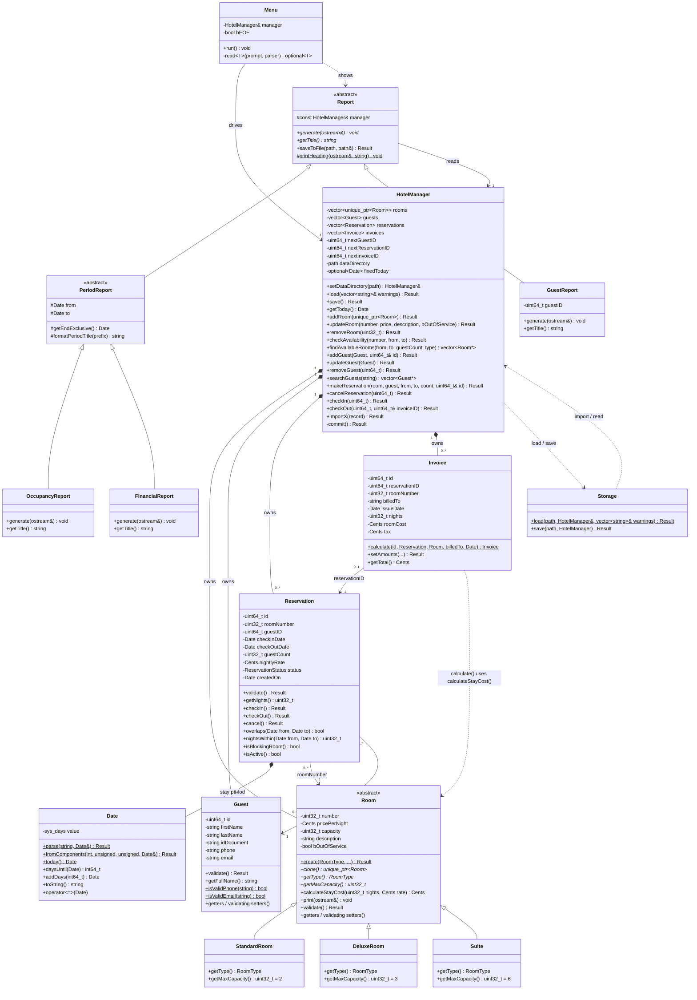

# HotelManager
Терминална програма за управление на резервации в хотел. 

Условие:

> ТЕМА5: Разработване на C++ система за резервации в хотел
> 
> Създайте C++ приложение за автоматизиране и оптимизиране на основните  процеси в хотелска среда. Приложението трябва да осигурява възможност за управление на стаи, клиенти, резервации и финансови услуги (фактуриране) чрез прилагане на основните принципи на обектно-ориентираното програмиране (енкапсулация, наследяване, полиморфизъм).
> 
> Системата трябва да поддържа следните ключови модули и структури от данни:
> 
> Стаи: информация за тип, цена за нощувка и наличност,
> 
> Клиенти: лични и контактни данни на гостите,
> 
> Резервации и фактуриране: управление на престоя, изчисление на крайна сума и генериране на отчети.
> 
> Изисквания:
> 
>> Автоматизация на хотелски операции: Приложението да предоставя възможност за централизирано управление на хотелските операции – проверка на наличността на стаите, правене на резервация, настаняване и изчисление на дължимите суми за престоя .
>> 
>> Генериране на отчети и справки: Да се имплементира функционалност за извеждане на отчети за заетостта на стаите, финансови отчети за периода и справки за клиенти с цел информирани бизнес решения .
>> 
>> ООП реализация, капсулация и полиморфизъм: Класовете (най-малко 3 класа – напр. Room, Guest/Customer, Reservation/HotelManager) трябва да капсулират всички детайли чрез private член-променливи, публични getters/setters и да прилагат наследяване и полиморфизъм, където е необходимо .
>> 
>> Проверка на данни и устойчивост: Необходимо е да се осигури валидация на входните данни (проверка за свободна стая за определен период, правилни дати, коректни суми) и устойчивост спрямо потребителски грешки .
>> 
>> Оператори и файлово съхранение: Да се предефинира операцията <<, която да се използва за извеждане на данните за резервациите и стаите .
>> 
>> Данните за стаите, клиентите и резервациите да се четат и трайно да се съхраняват във файл за осигуряване на непрекъсната работа между отделните сесии.
>> 
>> UML Диаграма: Класовете и връзките между тях да се опишат с UML клас диаграма .

Функционалности:

- Стаи - 3 вида стаи с различен капацитет и цена
- Гости - системата запаметява лична информация за всеки гост(име, номер на личен документ, телефон, имейл)
- Резервации - поддържа проверка на възможни резервации, резервиране, премахване на резервация, настаняване и напускане на стаята
- Фактуриране - генериране на фактури при напускане на стаята. Фактурата включва всички реално използвани нощувки по цената от резервацията и 10% ДДС
- Отчети - заетост на стаите и финансови отчети за различните видове стаи, за даден гост или за всички гости
- Валидация и устойчивост - всички данни се валидират и всяка операция връща променлива, показваща дали операцията е завършила успешно, или с грешка

Програмата идва с примерни данни от папката `Data`, които се копират и използват автоматично при компилиране.

## Компилация
Нужни са CMake 3.21+ и компилатор, който поддържа C++ 20(GCC, Clang или MSVC):
```bash
mkdir build && cd build
cmake ..
make
```
## Инструкции
Употреба:

```bash
cd build
./HotelManager
```

## Файлове
Всеки ред съдържа един запис, като полетата са разделени с `|`. Символът `\` може да се използва за escape-ване на `|` и `\`.

| Файл | Полета |
|---|---|
| `rooms.txt` | `number\|type\|pricePerNightCents\|capacity\|outOfService\|description` |
| `guests.txt` | `id\|firstName\|lastName\|idDocument\|phone\|email` |
| `reservations.txt` | `id\|room\|guestID\|checkIn\|checkOut\|guestCount\|nightlyRateCents\|status\|createdOn` |
| `invoices.txt` | `id\|reservationID\|room\|billedTo\|issueDate\|nights\|roomCost\|tax\|total` |

## UML диаграма
UML диаграмата описва отношенията между всички класове.
Рендерираната версия е качена като файлът `UML.png`.

Легенда:
- `-` private
- `+` public
- `#` protected
- `*` pure virtual
- `$` static.


